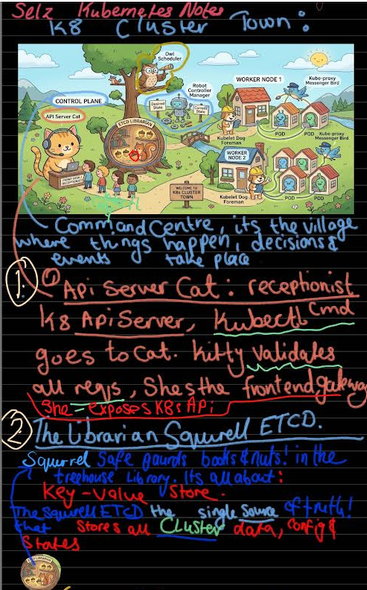
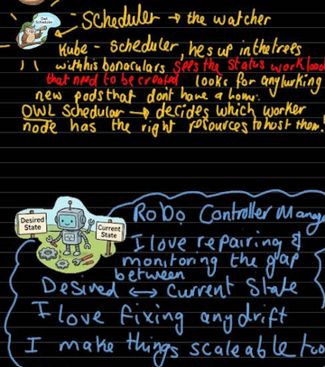
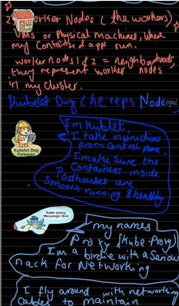
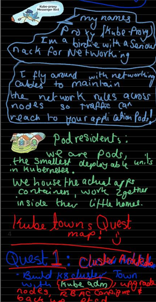
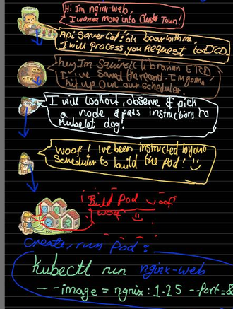

# 🌌 Selz's Cluster Ville

> A tiny space colony where animals, robots and aliens work together to keep Kubernetes running.

---

# 🚀 Cluster Architecture

## Mission 

Before deploying alien workloads across the galaxy, we need to understand how Cluster Ville operates.

### Topics Covered

- ✅ Kubernetes Architecture
- ✅ ETCD
- ✅ ETCD in Kubernetes
- ✅ Kube API Server
- ✅ Controller Manager
- ✅ Scheduler
- ✅ Kubelet

---

# 🪐 Welcome to Cluster Ville

Cluster Ville is a floating Ville orbiting Planet Kubernetes.

Theres main characters! Say hi to the following: 
## 🐱 The Reception Cat (Kube API Server)
## 🐿️ The Squirrel Librarian (ETCD)
## 🦉 The Scheduler 
## 🤖 The  Robot Controller Manager
## 🏠Worker Node 1 (VM or Physical machine)
   ## 🐦‍⬛ The Kube-Proxy birdie
   ## 🐶 The Kubelet Dog 
   ## The Pods cute lil Alien dudes👽

---

